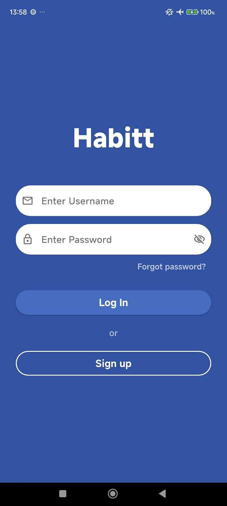
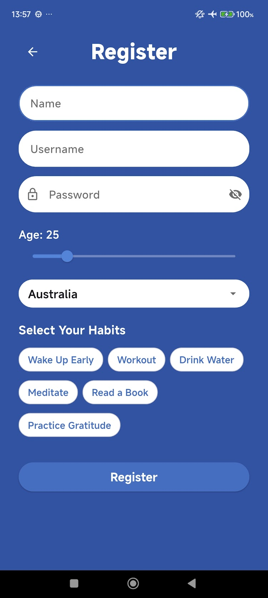
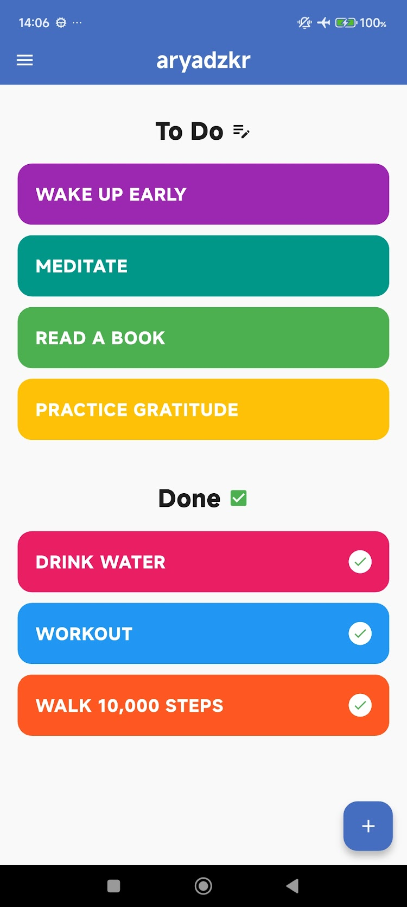
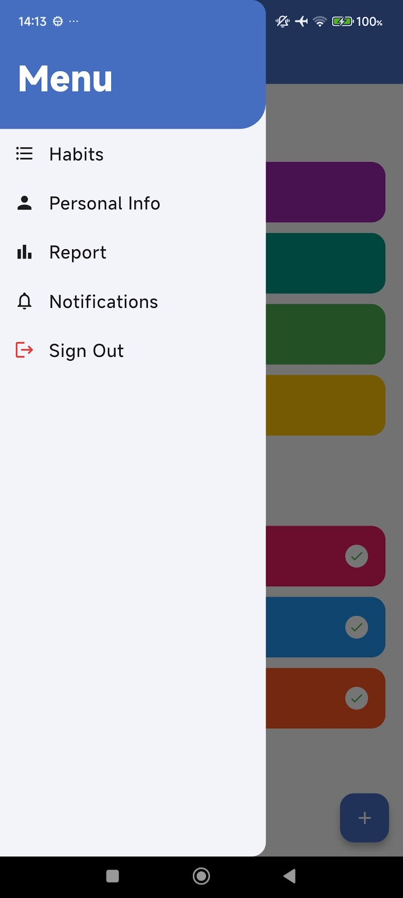
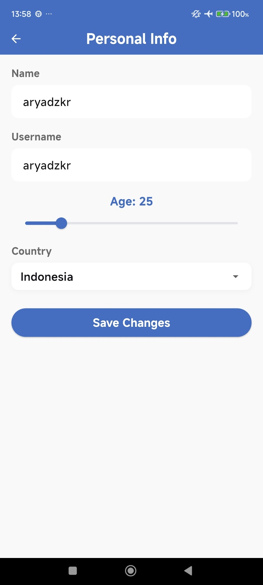
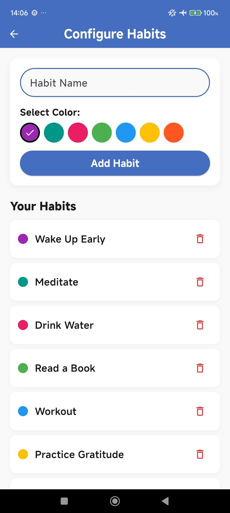
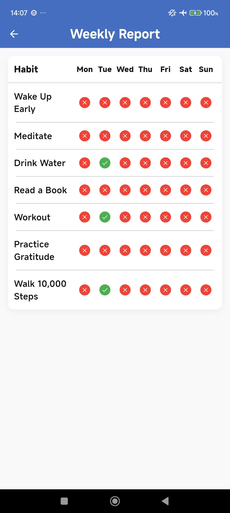
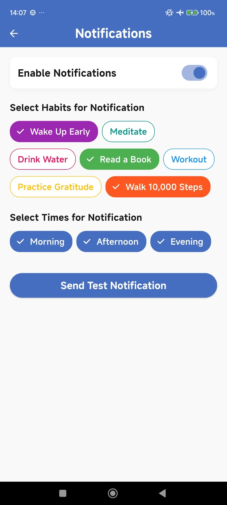

# Habitt 🎯

A simple yet powerful **habit tracking app** built with Flutter. Track your daily habits, visualize your weekly progress, and stay motivated with smart reminders.

> **Final Project** for the **IBM iOS and Android Mobile App Developer Professional Certificate** (Coursera).

## 📱 Screenshots

|               Login               |                Register                 |              Home               |
| :-------------------------------: | :-------------------------------------: | :-----------------------------: |
|  |  |  |

|              Menu               |                Personal Info                |               Configure Habits                |
| :-----------------------------: | :-----------------------------------------: | :-------------------------------------------: |
|  |  |  |

|               Weekly Report                |                   Notifications                   |
| :----------------------------------------: | :-----------------------------------------------: |
|  |  |

> Note: Screenshots will be added after final UI polishing.

## ✨ Features

### Core Features

- 🔐 **User Authentication** — Register & login with hashed passwords (SHA-256).
- 👤 **Multi-User Support** — Seamlessly switch between multiple accounts on the same device.
- ✅ **Habit Tracking** — Create, customize, delete, and track daily habits.
- 👆 **Swipe Gestures** — Swipe left to mark a habit as done, swipe right to undo.
- 🎨 **Color-Coded Habits** — Personalize each habit with custom color themes.
- 📊 **Weekly Report** — Visual matrix tracking habit completion across the week (Mon–Sun).
- 🔔 **Local Notifications** — Customizable daily reminders (morning, afternoon, evening).
- 💾 **Offline Data Persistence** — All user data and habit logs are saved locally via `SharedPreferences`.

### UX & Technical Details

- Smooth, declarative navigation powered by `go_router`.
- Clean and responsive Material 3 design system.
- Comprehensive form validation across all user inputs.
- Thoughtful empty state handling and confirmation dialogs for destructive actions.

---

## 🛠️ Tech Stack

| Layer                | Technology                                |
| :------------------- | :---------------------------------------- |
| **Framework**        | Flutter 3.47.x (stable)                   |
| **Language**         | Dart 3.13.x                               |
| **State Management** | Provider                                  |
| **Navigation**       | `go_router`                               |
| **Local Storage**    | `shared_preferences`                      |
| **Notifications**    | `flutter_local_notifications`, `timezone` |
| **Typography**       | `google_fonts` (Poppins)                  |
| **Security**         | `crypto` (SHA-256 Password Hashing)       |
| **UI/UX Design**     | Figma                                     |

## 🏗️ Architecture

This project follows a **feature-first** folder structure for scalability and maintainability:

```text
lib/
├── core/              # Shared utilities & UI components
│   ├── constants/     # App-wide colors, strings, and constants
│   ├── theme/         # Material 3 theme configuration
│   ├── utils/         # Helpers and form validators
│   └── widgets/       # Reusable custom widgets
├── features/          # Feature-specific modules
│   ├── auth/          # Login, registration, and user models
│   ├── habits/        # Habit CRUD and state management
│   ├── home/          # Main dashboard and swipeable habit lists
│   ├── profile/       # User personal info management
│   ├── reports/       # Weekly habit completion matrix
│   └── notifications/ # Reminder scheduling and settings
├── routes/            # Declarative routing configuration (go_router)
└── main.dart          # Application entry point
```

## 🚀 Getting Started

### Prerequisites

- **Flutter SDK:** `3.47.x` or later
- **Android SDK:** `36` (compileSdk)
- **Java:** `17` (LTS)
- **IDE:** Android Studio or VS Code

### Installation & Setup

1. **Clone the repository:**

```bash
   git clone https://github.com/your-username/coursera_mobile_app_dev_capstone.git
   cd coursera_mobile_app_dev_capstone
```

2. **Install dependencies:**

```bash
   flutter pub get
```

3. **Run the app in debug mode:**

```bash
   flutter run
```

4. **Build the release APK:**

(Ensure `android/key.properties` and your signing keystore are configured first)

```bash
   flutter build apk --release
```

   The compiled APK will be generated at: `build/app/outputs/flutter-apk/app-release.apk`

## 📖 User Stories

### Authentication

- ✅ **As a user**, I want to register with my name, username, password, age, and country so I can create a personalized account.
- ✅ **As a user**, I want to log in with my username and password so I can access my saved habits.
- ✅ **As a user**, I want to see a clear error message if I enter invalid credentials.

### Habit Management

- ✅ **As a user**, I want to add new habits with a custom name and color.
- ✅ **As a user**, I want to delete habits I no longer need.
- ✅ **As a user**, I want to mark habits as completed by swiping left.
- ✅ **As a user**, I want to undo a completed habit by swiping right.

### Home Screen

- ✅ **As a user**, I want to see my name in the app header so I know I am logged into my account.
- ✅ **As a user**, I want to see my daily habits organized into "To Do" and "Done" sections.
- ✅ **As a user**, I want to see a helpful empty state prompt when I haven't created any habits yet.

### Personal Info

- ✅ **As a user**, I want to view and edit my profile details (name, username, age, and country).
- ✅ **As a user**, I want my updated name to immediately reflect in the app header after saving.

### Reports

- ✅ **As a user**, I want to view a weekly report summarizing my habit consistency.
- ✅ **As a user**, I want to see a daily breakdown of completed (`✓`) and incomplete (`✗`) habits.

### Notifications

- ✅ **As a user**, I want to toggle app notifications on or off.
- ✅ **As a user**, I want to choose which specific habits trigger reminders.
- ✅ **As a user**, I want to select preferred reminder times (morning, afternoon, evening).
- ✅ **As a user**, I want to send a test notification to verify that alerts work properly on my device.

### Sign Out

- ✅ **As a user**, I want to securely log out from the menu to protect my account on shared devices.

## 🧪 Testing Checklist

- [x] Register new account → Success
- [x] Login with valid credentials → Success
- [x] Login with invalid credentials → Displays error message
- [x] Add habit → Appears in Home ("To Do")
- [x] Delete habit → Removes habit from Home
- [x] Swipe left on habit → Moves to "Done"
- [x] Swipe right on habit → Returns to "To Do"
- [x] Edit profile → Updates user info and header display
- [x] Open weekly report → Displays accurate completion matrix
- [x] Enable notifications → Test notification triggers successfully
- [x] Restart app → All user and habit data persists locally
- [x] Logout → Redirects cleanly to the login screen

## 📄 License

This project was created for educational purposes as part of the **IBM iOS and Android Mobile App Developer Professional Certificate** on Coursera.
